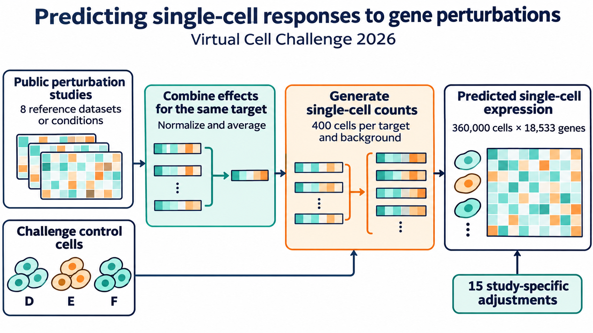

# wyqmath-vcc2026

A reference-transfer method for predicting single-cell RNA count distributions
after gene perturbation in the 2026 Virtual Cell Challenge.



*Graphical abstract generated with GPT.*

Our best submission achieved an **overall score of 0.1631 and ranked 228th
of 806**. It combines eight reference datasets or conditions with adjustments
for 15 pairs of cell background and target gene. An experimental version adds
three adjustments that reduced prediction error in held-out public data.

[Official final leaderboard](https://virtualcellchallenge.org/leaderboard#final)

## Reference transfer and count generation

The challenge labels its three anonymized cell backgrounds D, E, and F.
The final panel asks for predictions for 300 targets per background on a
shared list of 18,533 genes. Predictions start from the non-targeting
control cells supplied for each background.
The cell lines listed below are from the public reference studies.

1. **Combine effects for the same target.** Match each reference vector to
   the challenge gene list and fill unmatched genes with zeros. Divide each
   nonzero vector by its Euclidean norm before averaging. Include a vector
   if the reference provides an estimate for the target, even if every entry
   is zero. Normalization lets us combine estimates from studies that measure
   effects on different scales.
2. **Set the effect magnitude by background.** Multiply the average effect by
   0.85 times a scale of about 67.77 for D or 24.61 for E and F.
   D also uses a multiplier of about 0.838. In D, halve the estimated effect
   for a gene if at least three references report a nonzero effect and at
   least two-thirds of those effects point in the opposite direction to
   the average.
3. **Generate 400 count profiles per target.** Draw 400 distinct control
   cells in each background with PCG64 seed 1, sort by their input row
   index, and shrink each template cell to 45% of its original profile
   plus 55% of the template mean. For gene `g` with mean control count
   `lambda[g]` across all control cells and transferred effect `d[g]`, round
   `400 * lambda[g] * 2**d[g]` to the nearest integer. Allocate that total
   across cells by multinomial sampling in proportion to their template
   counts for the gene. Use one PCG64 random number sequence per background
   with seed 0 and process targets in the challenge order. Reuse the original
   random state when resampling a gene so that later draws are unaffected.
4. **Calibrate D and apply study-specific replacements.** In D, 16 rounds
   of integer exchanges between cells adjust the mean of the per-cell
   expression proportions. The target starts from the mean per-cell
   proportions in the controls, reweights them by `2**d[g]`, and renormalizes
   over genes with positive simulated totals.
   Each exchange preserves each cell's library size and each gene's total
   count. E and F use the sampled counts directly. The submission then
   applies adjustments from additional studies to the 15 pairs listed below.

The predictor writes a sparse H5AD with 360,000 cells and 18,533 genes.
`X` contains raw int32 counts, and `obs` identifies the context and target.
The method estimates perturbation effects from public data and transfers
them using fixed parameters.

## Reference datasets

These are the eight reference datasets or conditions and the methods used
to estimate their effects. The filenames are required by `prepare-bank`.

| Input file | Dataset | How the effect was estimated |
| --- | --- | --- |
| `gw.npz` | Replogle et al., K562 genome-wide CRISPRi. [Paper](https://doi.org/10.1016/j.cell.2022.05.013), [data](https://plus.figshare.com/ndownloader/files/35775507) | Pooled counts rescaled to a common sequencing depth, then a log2 ratio to the controls with pseudocount 1 |
| `hct116.npz` | HCT116, [X-Atlas-Orion](https://huggingface.co/datasets/Xaira-Therapeutics/X-Atlas-Orion) | Log2 ratio of mean counts per cell in the perturbed and non-targeting control groups, with pseudocount 1 |
| `hek293t.npz` | HEK293T, [X-Atlas-Orion](https://huggingface.co/datasets/Xaira-Therapeutics/X-Atlas-Orion) | Same calculation using HEK293T controls |
| `cd4_Rest.npz` | Resting CD4 T cells, [GSE314342](https://www.ncbi.nlm.nih.gov/geo/query/acc.cgi?acc=GSE314342) | Effects reported by the study in the `log_fc` layer of `GWCD4i.DE_stats.h5ad` |
| `cd4_Stim8hr.npz` | CD4 T cells after 8 h of stimulation, [GSE314342](https://www.ncbi.nlm.nih.gov/geo/query/acc.cgi?acc=GSE314342) | Effects reported for the 8 h condition |
| `cd4_Stim48hr.npz` | CD4 T cells after 48 h of stimulation, [GSE314342](https://www.ncbi.nlm.nih.gov/geo/query/acc.cgi?acc=GSE314342) | Effects reported for the 48 h condition |
| `dld1v2.npz` | DLD-1, [GSE337988](https://www.ncbi.nlm.nih.gov/geo/query/acc.cgi?acc=GSE337988) | Pooled 44 pairs of expression and guide-count files. Assigned each cell to the guide with the most observed molecules, discarding ties. Calculated the log2 ratio of mean counts per cell in the perturbed and control groups with pseudocount 1. |
| `h1scmg.npz` | H1 embryonic stem-cell CRISPRi screen, [GSE295214](https://www.ncbi.nlm.nih.gov/geo/query/acc.cgi?acc=GSE295214) | Grouped cells by their assigned guide target and calculated the log2 ratio of mean counts per cell to pooled controls with pseudocount 1 |

For CD4 T cells, we excluded records that the study flagged for low
expression of the target gene and used the first remaining estimate for
each target and condition. [Study data guide](https://github.com/emdann/GWT_perturbseq_analysis_2025/blob/master/metadata/data_sharing_readme.md)

## Additional datasets used in the submission

For each pair below, the submission uses a separately prepared matrix of
400 predicted cells informed by the corresponding study.

| Challenge background | Target gene | Dataset | Expression data used |
| --- | --- | --- | --- |
| D | ANP32B | [GSE242849](https://www.ncbi.nlm.nih.gov/geo/query/acc.cgi?acc=GSE242849) | FPKM expression values from MV4-11 cells treated with a short hairpin RNA targeting ANP32B and from cells annotated as untreated controls |
| D | CARM1 | [GSE103528](https://www.ncbi.nlm.nih.gov/geo/query/acc.cgi?acc=GSE103528) | RSEM estimates from RNA collected in MOLM-13 cells three days after lentiviral delivery of one of two CARM1-targeting short hairpin RNAs or a scrambled control |
| D | PHF6 | [GSE277149](https://www.ncbi.nlm.nih.gov/geo/query/acc.cgi?acc=GSE277149) | RNA-seq gene counts from THP-1 cells, generated with featureCounts |
| D | RBM5 | [GSE225633](https://www.ncbi.nlm.nih.gov/geo/query/acc.cgi?acc=GSE225633) | RSEM read estimates from MOLM-13 cells |
| D | SMARCD1 | [GSE200201](https://www.ncbi.nlm.nih.gov/geo/query/acc.cgi?acc=GSE200201) | Single-cell RNA counts from MOLM-13 cells |
| E | PHF23 | [GSE300095](https://www.ncbi.nlm.nih.gov/geo/query/acc.cgi?acc=GSE300095) | RNA-seq gene counts from PHF23-knockout and wild-type HeLa cells measured under baseline conditions |
| E | PRMT6 | [GSE221971](https://www.ncbi.nlm.nih.gov/geo/query/acc.cgi?acc=GSE221971) | Deposited RNA-seq gene counts from U87 cells |
| E | VIM | [GSE286944](https://www.ncbi.nlm.nih.gov/geo/query/acc.cgi?acc=GSE286944) | RNA-seq gene counts from U251-MG cells, generated with featureCounts |
| F | CUX1 | [GSE154148](https://www.ncbi.nlm.nih.gov/geo/query/acc.cgi?acc=GSE154148), [GSE129487](https://www.ncbi.nlm.nih.gov/geo/query/acc.cgi?acc=GSE129487) | Gene expression changes reported by the first study, refined using RNA-seq estimates from synovial fibroblasts from four donors with rheumatoid arthritis |
| F | E2F1 | [GSE77260](https://www.ncbi.nlm.nih.gov/geo/query/acc.cgi?acc=GSE77260) | RNA-seq read estimates from Wharton's jelly mesenchymal cells, generated with Partek |
| F | GATAD2B | [GSE154148 supplementary data](https://doi.org/10.1038/s41556-021-00725-7) | Gene expression changes reported by the study |
| F | HMGB2 | [GSE269856](https://www.ncbi.nlm.nih.gov/geo/query/acc.cgi?acc=GSE269856) | RNA-seq gene counts from proliferating IMR-90 fibroblasts |
| F | PHF14 | [GSE131576](https://www.ncbi.nlm.nih.gov/geo/query/acc.cgi?acc=GSE131576) | RNA-seq gene counts from proliferating WI-38 fibroblasts, generated with HTSeq |
| F | PRDM15 | [GSE154148 supplementary data](https://doi.org/10.1038/s41556-021-00725-7) | Gene expression changes reported by the study |
| F | PTBP2 | [GSE210131](https://www.ncbi.nlm.nih.gov/geo/query/acc.cgi?acc=GSE210131), [study protocol](https://pmc.ncbi.nlm.nih.gov/articles/PMC10679656/) | RNA-seq gene counts from AG22056 skin fibroblasts collected three days after starting neuronal induction, with and without an added short hairpin RNA targeting PTBP2 |

## Experimental candidate

The candidate changes the predictions for three additional targets in background E.
For each comparison, we pooled the treatment and control samples separately
and normalized each group to 10,000 counts across genes shared with the
challenge. With a pseudocount of 0.1, we calculated the log2 ratio of the
treatment to control counts. We used the study estimate in place of the
average reference effect for measured genes with an absolute log2 change
of at least 0.5. To generate the candidate after evaluation, estimate each
effect from all listed samples, pooling both cell lines for NR2C2.

| Target in background E and dataset | Samples held out for evaluation | MSE for response genes | MSE across shared genes |
| --- | --- | ---: | ---: |
| NR2C2, [GSE299760](https://www.ncbi.nlm.nih.gov/geo/query/acc.cgi?acc=GSE299760). MCF7 and T47D, three siRNA-treated and three scrambled-control samples per cell line, collected after 72 h | Estimate the effect in one cell line and evaluate it in the other, in both directions | 0.280 to 0.140 | 0.043 to 0.038 |
| ADNP, [GSE79395](https://www.ncbi.nlm.nih.gov/geo/query/acc.cgi?acc=GSE79395). HCT116, three siRNA-treated and three control samples | Hold out one treated sample and one control, repeating for all nine pairs | 0.378 to 0.112 | 0.028 to 0.025 |
| ZBTB48, [GSE228606](https://www.ncbi.nlm.nih.gov/geo/query/acc.cgi?acc=GSE228606). HEK293, two siRNA-treated and two non-targeting control samples, collected after 72 h | Hold out one treated sample and one control, repeating for all four pairs | 0.574 to 0.183 | 0.077 to 0.049 |

Mean squared error (MSE) compares log2 changes calculated from the predicted
counts with those measured in the held-out samples. The table gives average
errors before and after the adjustments. Response genes meet the 0.5
threshold using only the samples used to estimate each effect. Both measures
exclude the perturbed gene. The ADNP and ZBTB48 comparisons reuse samples.
The experimental candidate has no official challenge score.

| Study samples | Treatment | Control | Gene counts |
| --- | --- | --- | --- |
| NR2C2 in MCF7 | GSM9045715 to GSM9045717 | GSM9045712 to GSM9045714 | STAR |
| NR2C2 in T47D | GSM9045721 to GSM9045723 | GSM9045718 to GSM9045720 | STAR |
| ADNP in HCT116 | GSM2094364 to GSM2094366 | GSM2094367 to GSM2094369 | HTSeq |
| ZBTB48 in HEK293 | GSM7133917 to GSM7133918 | GSM7133919 to GSM7133920 | RSEM expected counts, including fractional values |

## Run

Use Python 3.11 or newer.

```sh
python -m pip install .
wyqmath-vcc smoke --output example.h5ad
```

The smoke test generates and reads back a synthetic H5AD with 48 cells
and six genes.

### Prepare inputs

Obtain the extracted final control bundle through the
[VCC data page](https://virtualcellchallenge.org/datasets) or the
[official CLI](https://vcc-cli-wiki.virtualcellchallenge.org/). The bundle
contains `manifest.json`, `gene_names.csv`, `pert_counts.csv`, and
`context_D.h5ad`, `context_E.h5ad`, and `context_F.h5ad`. Preserve the
original control row order.

To estimate a new effect from processed expression data, provide a
tab-separated count table with a `gene` column and one column per sample,
and a tab-separated sample table with `sample`, `target`, and
`condition` columns. Use `perturbed` or `control` as the condition and
`*` as the target for shared controls. Use gene symbols that match the
challenge gene list uniquely. Fractional expected counts,
such as RSEM estimates, are supported. The default pools samples by
condition before normalization. To average normalized libraries instead,
use `--normalization library-mean-cp10k`.

```sh
wyqmath-vcc estimate-source \
  --counts source-counts.tsv \
  --samples source-samples.tsv \
  --output source-effects.npz
```

Use the eight filenames in the reference dataset table to prepare the
combined reference file. Each input contains Unicode `genes` and `targets`
vectors and a float32 or float64 `effects` array of shape `(targets, genes)`.
Include genes measured in the study and targets with an available effect
estimate. To reproduce the submitted method, use the effect calculation
listed for each study. The `estimate-source` command implements the pooled
count calculation used for the three experimental adjustments.

```sh
wyqmath-vcc prepare-bank \
  --controls controls-final \
  --sources reference-effects \
  --output source-bank.npz
```

The combined file contains aligned effects in `raw` (source by target by
gene). Boolean arrays `admitted` and `present` indicate which targets and
genes each source covers. The `targets`, `genes`, and `sources` arrays
give the corresponding labels. Each challenge target needs an estimate
from at least one source.

### Generate predictions

To generate predictions with the submitted method, supply all 15
replacement count files listed under the additional datasets.

```sh
wyqmath-vcc predict \
  --controls controls-final \
  --source-bank source-bank.npz \
  --patches submitted-counts \
  --output submitted-prediction.h5ad
```

A replacement count file is named `<context>/<target>.npz`, for example
`D/CARM1.npz`. It contains a compressed sparse row (CSR) matrix of int32
counts with 400 cells and 18,533 genes, in the sampled cell order and the
challenge gene order. Store sorted, unique column indices in each row.
The loader accepts SciPy sparse NPZ files or arrays
named `data`, `indices`, `indptr`, and `shape`. Omit `--patches` to generate
a prediction using only the eight reference datasets or conditions.

To generate the experimental candidate, provide one effect file for each
of the three additional targets.

```sh
wyqmath-vcc predict \
  --controls controls-final \
  --source-bank source-bank.npz \
  --variant experimental18 \
  --patches submitted-counts \
  --experimental-effects experimental-effects \
  --output experimental-prediction.h5ad
```

The experimental effects directory contains `NR2C2.npz`, `ADNP.npz`,
and `ZBTB48.npz`. Generate each file with `estimate-source` and its default
settings, using the genes with a unique match between the study and the
challenge. If all 18 replacement count files are already available, pass
their directory to `--patches` and omit `--experimental-effects`.

The code estimates effects from prepared count tables, combines reference
effects, and generates predictions. Reproducing the submission requires
the challenge controls, the original reference effect estimates, and the
15 prepared count files. Preparing study inputs from sequencing reads
requires separate processing. To evaluate predictions against matched
experimental data, use
[Arc's cell-eval2](https://github.com/ArcInstitute/cell-eval2).
